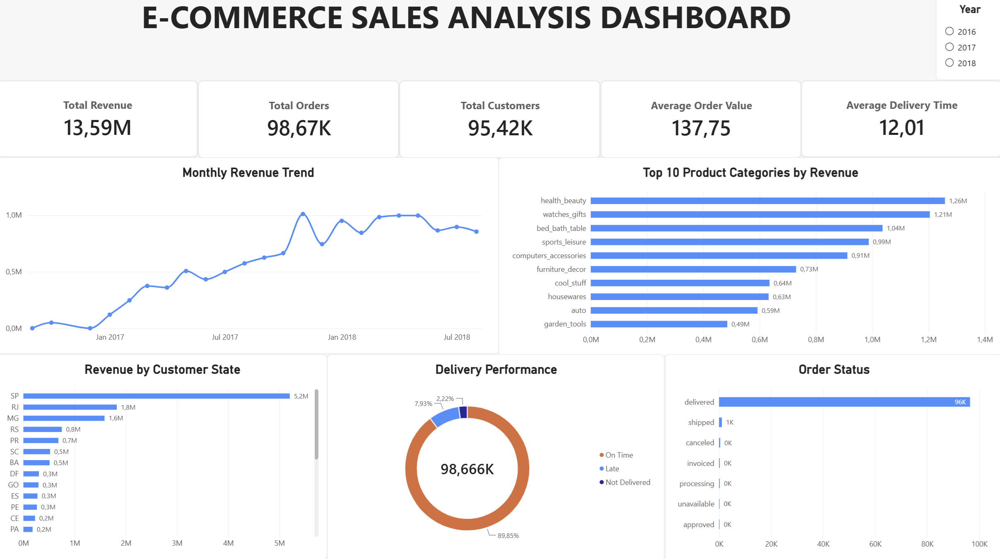

# E-Commerce Sales Analysis

This project analyzes Brazilian e-commerce sales data from the Olist dataset using PostgreSQL, SQL, and Power BI. The project covers data loading, data quality checks, SQL-based transformation and analysis, and the development of an interactive Power BI dashboard to identify sales, customer, product, and delivery insights.

## Dashboard

## Tools & Technologies

- PostgreSQL
- SQL
- Power BI
- DAX
- Visual Studio Code
- Git & GitHub

## Project Workflow

1. Loaded raw Olist e-commerce CSV datasets into PostgreSQL.
2. Performed data exploration and data quality checks using SQL.
3. Joined customer, order, order item, product, and category data.
4. Created a transformed `sales_analysis` view for reporting and analysis.
5. Analyzed revenue, orders, customers, product categories, geographic performance, and delivery performance.
6. Connected PostgreSQL to Power BI.
7. Built an interactive Power BI dashboard with KPIs, analytical visuals, and a year filter.

## Key Metrics

- Total Revenue: 13.59M
- Total Orders: 98.67K
- Total Customers: 95.42K
- Average Order Value: 137.75
- Average Delivery Time: 12.01 days

## Business Questions

This project explores several key business questions:

- How has revenue changed over time?
- Which product categories generate the most revenue?
- Which customer states contribute the most revenue?
- What proportion of orders are delivered on time, late, or not delivered?
- What is the distribution of order statuses?
- How many unique customers and orders are represented in the sales data?

## Data Model

The analysis combines five Olist datasets:

- `customers` – customer location and unique customer information
- `orders` – order status and purchase/delivery timestamps
- `order_items` – product, price, freight, and seller information for each order item
- `products` – product category and product attributes
- `category_translation` – English translations of product category names

These tables were joined in PostgreSQL to create the `sales_analysis` view used for analysis and Power BI reporting.

## SQL Transformation

A reporting view named `sales_analysis` was created in PostgreSQL to combine and transform the source tables.

The transformation includes:

- Joining orders, customers, order items, products, and category translations
- Creating purchase year and month fields for time-based analysis
- Calculating delivery time in days
- Classifying deliveries as On Time, Late, or Not Delivered
- Translating product category names into English
- Calculating total item value from product price and freight value

## Power BI Dashboard

The transformed PostgreSQL data was connected to Power BI to create an interactive dashboard.

The dashboard includes:

- Total Revenue
- Total Orders
- Total Customers
- Average Order Value
- Average Delivery Time
- Monthly Revenue Trend
- Top 10 Product Categories by Revenue
- Revenue by Customer State
- Delivery Performance
- Order Status
- Interactive Year filter

The incomplete September 2018 period contains only one record and was excluded from the monthly revenue trend visual to avoid presenting a partial month as a meaningful decline.

## Key Insights
- São Paulo (SP) generated the highest revenue among all customer states, making it the strongest geographic market in the dataset.
- Health & Beauty was the highest-revenue product category, indicating its strong contribution to overall e-commerce sales.
- Most orders were delivered on time, while late and undelivered orders represented a relatively small share of total orders.
- Delivered orders accounted for the vast majority of order statuses, with canceled, shipped, invoiced, processing, unavailable, and approved orders representing much smaller volumes.

## Project Structure

ecommerce-sales-analysis/
- data/ – Raw Olist CSV datasets (stored locally and excluded from Git)
- sql/ – SQL exploration and transformation scripts
- powerbi/ – Power BI dashboard file
- images/ – Dashboard screenshots
- docs/ – Supporting project documentation
- README.md – Project overview and findings

